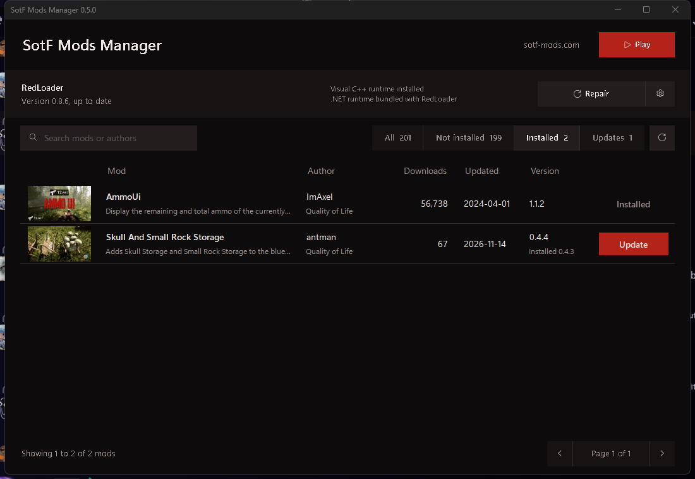
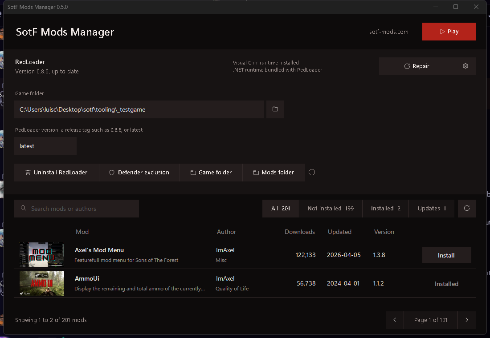

# SotF Mods Manager

**Install RedLoader and Sons of the Forest mods in one click.**
Made by [sotf-mods.com](https://sotf-mods.com) for the community.


## For players

1. Download `SotfModsManager.exe` from [Releases](../../releases/latest).
2. Open it. If RedLoader is missing, click **Install**.
3. Pick mods from the list and click **Install** on each one.
4. Click **Play** to start the game through Steam. The first start with RedLoader can take a few minutes.

You don't need to install .NET or move files by hand. The manager finds your game and installs anything that's missing.

Windows SmartScreen may warn you the first time because the exe isn't signed. Click **More info**, then **Run anyway**. You can read the [whole source code](src) or build it yourself (see below).

## Mod list



- Shows every approved Sons of the Forest mod on sotf-mods.com, with its picture and description. All of them run on RedLoader.
- Tabs: **All**, **Not installed**, **Installed** and **Updates**, each with its count.
- Click a column header to sort by name, author, downloads, release date or version.
- Search by mod name or author.
- Pages show exactly the mods that fit in the window. Use the arrows or the mouse wheel to change page.
- When a mod you have gets a new release, its button turns red and reads **Update**, and the version column shows which one you have.
- Dependencies are installed first, automatically. Double-click a mod to open its page.

## RedLoader and dependencies

| Dependency | How the manager handles it |
|---|---|
| RedLoader | Installs, repairs or updates it from the official GitHub releases |
| Visual C++ 2015-2022 x64 runtime | Installs it from Microsoft if it's missing (RedLoader's splash screen needs it) |
| .NET 6 runtime | Nothing to do: RedLoader ships its own copy |
| .NET Framework 4.8 (to run this tool) | Already part of Windows 10 and 11 |

## Settings



- **Game folder**: pick it by hand if the game isn't in a standard Steam library.
- **RedLoader version**: `latest`, or a release tag such as `0.8.5` to pin or downgrade.
- **Uninstall RedLoader**: removes `version.dll`, `doorstop_config.ini` and `_Redloader`. Your mods are kept, and the notification offers **Undo**.
- **Defender exclusion**: Defender's scan of the RedLoader files can stall the first start for minutes ([RedLoader#49](https://github.com/ToniMacaroni/RedLoader/issues/49)). This excludes the game folder. Asks for admin rights.
- Shortcuts to the game and `Mods` folders.

## Feedback

Every task shows a notification in the bottom right corner that goes from progress (with downloaded MB) to success or error. Errors stay until you close them and offer **Retry**. On startup the manager checks for new RedLoader and SotF Mods Manager releases, and skips the check silently when offline.

## Lightweight by design

- A single ~55 KB native exe on .NET Framework 4.8, which comes with Windows. No runtime to download.
- No external libraries. Icons come from the Windows icon font, text uses Segoe UI Variable (Segoe UI on Windows 10) and WebP pictures are decoded by Windows itself.
- Only the mods on the current page become rows, and a picture is downloaded the first time it's shown. Pictures are the site's 320 px copies, resized to the thumbnail and cached in `%LOCALAPPDATA%\SotfModsManager	humbs`.
- Downloads, decoding and extraction run in the background, so the window stays responsive on low-end PCs.

## How it works

1. Finds the game through Steam's uninstall registry key (AppID 1326470), then every library in `libraryfolders.vdf`.
2. Reads mods from the sotf-mods.com API and downloads them from there.
3. Extracts zips with protection against zip-slip paths and refuses to touch files while the game is running.
4. Reads installed versions from `_Redloader/info.json` and each mod's `manifest.json`.

## Source

| File | What it does |
|---|---|
| [MainWindow.cs](src/MainWindow.cs) | Builds the window and keeps its state |
| [ModList.cs](src/ModList.cs) | Loads, filters, sorts, pages and draws the mod list |
| [Install.cs](src/Install.cs) | Installs RedLoader, mods and dependencies; uninstall, Defender, Play |
| [Toasts.cs](src/Toasts.cs) | Notifications |
| [Ui.cs](src/Ui.cs) | Theme and reusable UI building blocks |
| [Platform.cs](src/Platform.cs) | Game folder, versions, files and network |

## Build

Windows already includes the C# compiler, so you don't need an SDK:

```bat
build.bat
```

## License

MIT
