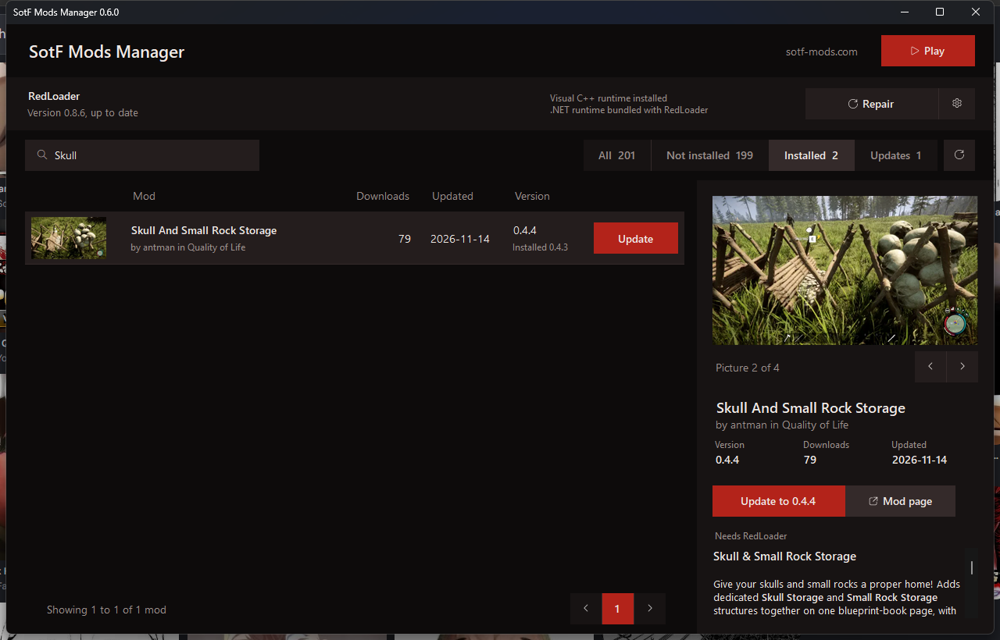
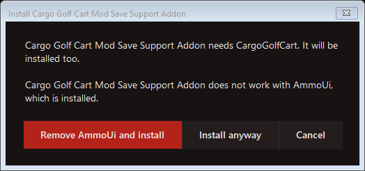
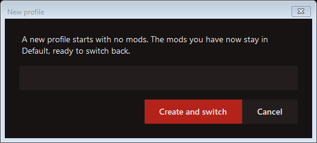

# SotF Mods Manager

**Install RedLoader and Sons of the Forest mods in one click.**
Made by [sotf-mods.com](https://sotf-mods.com) for the community.


## For players

1. Download `SotfModsManager.exe` from [Releases](../../releases/latest).
2. Open it. If RedLoader is missing, click **Install**.
3. Pick mods from the list and click **Install** on each one.
4. Click **Play** to start the game through Steam. The first start with RedLoader can take a few minutes.

You don't need to install .NET or move files by hand. The manager finds your game and installs anything that's missing.

Windows SmartScreen may warn you the first time because the exe isn't signed. Click **More info**, then **Run anyway**. You can read the [whole source code](src) or build it yourself (see below).

## Mod list


- Shows every approved Sons of the Forest mod on sotf-mods.com, with its picture, author and category. All of them run on RedLoader.
- Tabs: **All**, **Not installed**, **Installed** and **Updates**, each with its count.
- Sort with the button under the list (most or least downloaded, recently updated, name), or click the Mod, Downloads or Updated header. The sorted column shows an arrow.
- Search by mod name or author.
- Pages show exactly the mods that fit in the window. Use the numbered page buttons, the arrows, the mouse wheel or Page Up and Page Down.
- When a mod you have gets a new release, its button turns red and reads **Update**, and the version column shows which one you have.

### Mod details



Select a mod to see its picture gallery, version, downloads, release date, dependencies and full description on the right. Click a picture to open it at full size.

### Dependencies and incompatibilities



Before installing, the manager tells you which dependencies it will install with the mod, and installs them first. If the mod does not work with a mod you have, it names it and lets you remove it and install, install anyway, or cancel. Incompatibilities come from the `incompatibilities` list of each mod on sotf-mods.com.

## Profiles



A profile is its own set of mods, for example one for solo and one for playing with friends. Use the profile button next to the search box to:

- **Switch** between profiles. The mods of the other profiles wait in `.sotfmm-profiles` inside the game folder, so switching only moves folders: instant, with no downloads.
- **New profile**: starts empty. The mods you have stay in the previous profile.
- **Export**: saves a small `.sotfprofile` file with the list of mods, to share with other players.
- **Import**: opens a `.sotfprofile` file, creates a new profile and downloads its mods and their dependencies from sotf-mods.com.
- **Delete**: removes the active profile and its mods, then switches to another one.

### Modpacks

Modpacks are profiles shared on sotf-mods.com. Install one in any of these ways, and it becomes a new profile with its mods and their dependencies:

- **Install modpack from link** in the profile menu: paste the modpack's link.
- Double-click a downloaded `.sotfprofile` file.
- Click **Open in launcher** on the modpack's page, which uses a `sotfmm://modpack/user/slug` link.

The manager registers `.sotfprofile` files and `sotfmm://` links for your Windows user each time it starts. No admin rights are needed.

## RedLoader and dependencies

| Dependency | How the manager handles it |
|---|---|
| RedLoader | Installs, repairs or updates it from the official GitHub releases |
| Visual C++ 2015-2022 x64 runtime | Installs it from Microsoft if it's missing (RedLoader's splash screen needs it) |
| .NET 6 runtime | Nothing to do: RedLoader ships its own copy |
| .NET Framework 4.8 (to run this tool) | Already part of Windows 10 and 11 |

## Logs and crashes

The **Logs** button opens RedLoader's log (`_Redloader/Latest.log`), its error log, the game's `Player.log` and the crash reports folder.

When the game crashes, the manager notices as soon as it closes and offers to open the logs. They usually name the mod that caused the crash, so you can send them to its author. This works whether you started the game from the manager or from Steam.

## Settings


- **Game folder**: pick it by hand if the game isn't in a standard Steam library.
- **RedLoader version**: `latest`, or a release tag such as `0.8.5` to pin or downgrade.
- **Uninstall RedLoader**: removes `version.dll`, `doorstop_config.ini` and `_Redloader`. Your mods are kept, and the notification offers **Undo**.
- **Defender exclusion**: Defender's scan of the RedLoader files can stall the first start for minutes ([RedLoader#49](https://github.com/ToniMacaroni/RedLoader/issues/49)). This excludes the game folder. Asks for admin rights.
- Shortcuts to the game and `Mods` folders.

## Feedback

Every task shows a notification in the bottom right corner that goes from progress (with downloaded MB) to success or error. Errors stay until you close them and offer **Retry**. On startup the manager checks for new RedLoader and SotF Mods Manager releases, and skips the check silently when offline.

## Lightweight by design

- A single ~110 KB native exe on .NET Framework 4.8, which comes with Windows. No runtime to download.
- No external libraries. Icons come from the Windows icon font, text uses Segoe UI and WebP pictures are decoded by Windows itself.
- Only the mods on the current page become rows, and a picture is downloaded the first time it's shown. Pictures are the site's 320 px copies, resized to the thumbnail and cached in `%LOCALAPPDATA%\SotfModsManager\thumbs`.
- Downloads, decoding and extraction run in the background, so the window stays responsive on low-end PCs.

## How it works

1. Finds the game through Steam's uninstall registry key (AppID 1326470), then every library in `libraryfolders.vdf`.
2. Reads mods from the sotf-mods.com API and downloads them from there.
3. Extracts zips with protection against zip-slip paths and refuses to touch files while the game is running.
4. Reads installed versions from `_Redloader/info.json` and each mod's `manifest.json`.

## Source

| File | What it does |
|---|---|
| [MainWindow.cs](src/MainWindow.cs) | Builds the window and keeps its state |
| [ModList.cs](src/ModList.cs) | Loads, filters, sorts, pages and draws the mod list |
| [Details.cs](src/Details.cs) | The details panel: gallery, facts and description |
| [Pictures.cs](src/Pictures.cs) | Downloads, decodes and caches pictures |
| [Install.cs](src/Install.cs) | Installs RedLoader, mods and dependencies; uninstall, Defender, Play |
| [Logs.cs](src/Logs.cs) | Logs menu and crash check |
| [Profiles.cs](src/Profiles.cs) | Mod profiles: switch, create, delete, export and import |
| [Toasts.cs](src/Toasts.cs) | Notifications and the confirmation dialog |
| [Ui.cs](src/Ui.cs) | Theme and reusable UI building blocks |
| [Platform.cs](src/Platform.cs) | Game folder, versions, files and network |

## Build

Windows already includes the C# compiler, so you don't need an SDK:

```bat
build.bat
```

## License

MIT
