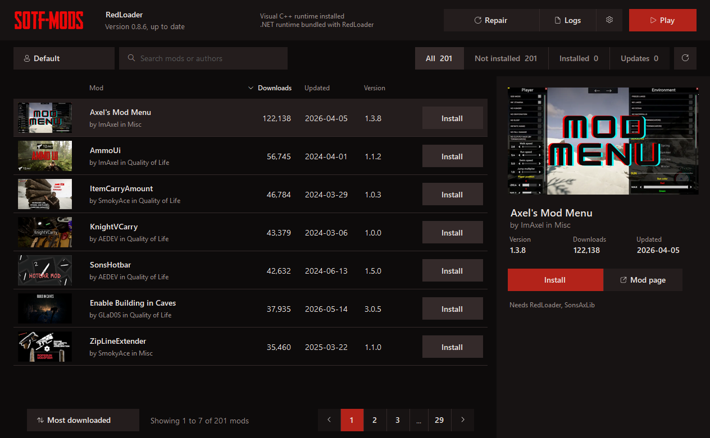
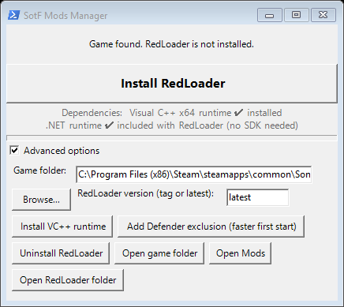

# SotF Mods Manager

**One-click [RedLoader](https://github.com/ToniMacaroni/RedLoader) installer for Sons of the Forest.**
Made by [sotf-mods.com](https://sotf-mods.com) for the community.



## For players

1. Download `SotfModsManager.exe` from [Releases](../../releases/latest).
2. Open it and click **Install RedLoader**.
3. Start the game from Steam. The first start can take a few minutes.

You don't need to install .NET or move files by hand. The manager finds your game and installs anything that's missing.

> Windows SmartScreen may warn you the first time because the exe isn't signed. Click **More info → Run anyway**.
> You can read the [whole source code](SotfModsManager.cs) (under 100 lines) or build it yourself (see below).

## Dependencies (handled for you)

| Dependency | How the manager handles it |
|---|---|
| Visual C++ 2015-2022 x64 runtime | Checks for it and installs it from Microsoft if it's missing (RedLoader's splash screen needs it) |
| .NET 6 runtime | Nothing to install: RedLoader already ships its own copy in `_Redloader/dotnet` |
| .NET Framework 4.8 (to run this tool) | Already part of Windows 10 and 11 |

## Advanced options



- **Game folder**: pick it by hand if the game isn't in a standard Steam library.
- **RedLoader version**: `latest`, or any release tag such as `0.8.5`, to downgrade or pin a version.
- **Install VC++ runtime**: install or repair it on its own.
- **Add Defender exclusion**: excludes the game folder from Microsoft Defender. Without it, Defender's cloud scan of the ~235 RedLoader assemblies can stall the first start for minutes ([RedLoader#49](https://github.com/ToniMacaroni/RedLoader/issues/49)). Asks for admin rights.
- **Uninstall RedLoader**: removes `version.dll`, `doorstop_config.ini` and `_Redloader/`. Your `Mods` folder is kept.
- Shortcuts to the game, `Mods` and `_Redloader` folders.

## Updates

- **RedLoader**: on startup the manager compares your installed version with the latest GitHub release. If a newer one exists, it shows "Update available" and the button becomes **Update to RedLoader X**.
- **The manager itself**: it tells you when a new SotF Mods Manager release is out and offers to open the download page.
- Without internet, or if GitHub doesn't answer, it skips the check silently and everything else keeps working.

## How it works

1. It finds the game through Steam's uninstall registry key (AppID 1326470), then through every library in `libraryfolders.vdf`.
2. It downloads `Redloader.zip` from the official GitHub releases.
3. It extracts the zip over the game folder, with protection against zip-slip paths.
4. It reads the installed version from `_Redloader/info.json`.

## Lightweight by design

- It's a ~20 KB native WinForms exe on .NET Framework 4.8, which comes with Windows. There's no runtime to download.
- Downloads and extraction run asynchronously, so the window stays responsive on low-end PCs.
- It uses about 35 MB of RAM.

## Build

You don't need an SDK, because Windows already includes the C# compiler:

```bat
build.bat
```

## License

MIT
