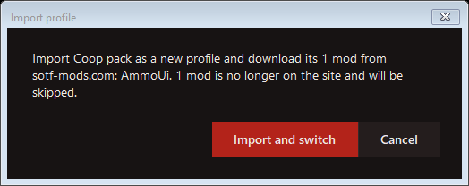
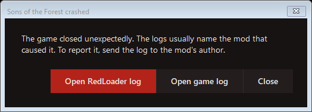
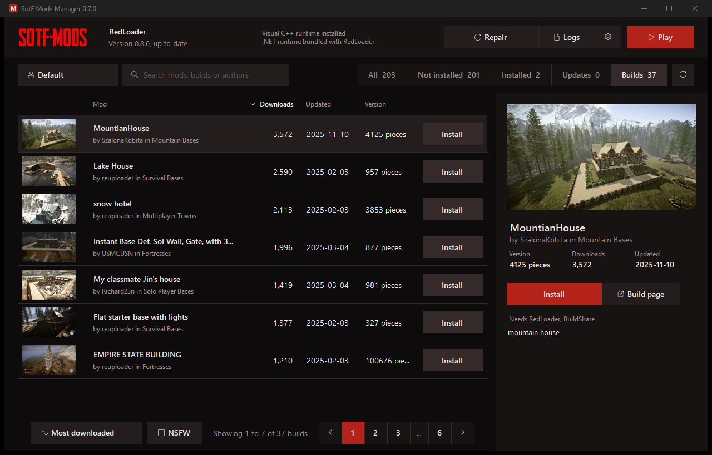

<div align="center">


# SotF Mods Manager

**The one-click mod manager for Sons of the Forest.**
Installs RedLoader and every mod and build on [sotf-mods.com](https://sotf-mods.com), keeps them updated and lets you switch between mod profiles.

[](https://github.com/ChoqueCastroLD/sotf-mods-manager/releases/latest)
[](https://github.com/ChoqueCastroLD/sotf-mods-manager/releases)
[](LICENSE)


[](https://sotf-mods.com)

[**Download for Windows**](https://github.com/ChoqueCastroLD/sotf-mods-manager/releases/latest/download/SotfModsManager.exe) &nbsp;&nbsp;|&nbsp;&nbsp; [Browse mods](https://sotf-mods.com) &nbsp;&nbsp;|&nbsp;&nbsp; [Report a problem](https://github.com/ChoqueCastroLD/sotf-mods-manager/issues)

<br>


</div>

## Features

<table>
<tr>
<td width="50%" valign="top">
<br>
<b>Every mod, with pictures.</b> Browse, search and sort all approved mods on sotf-mods.com. NSFW mods stay hidden until you tick <b>NSFW</b>. Select one to see its gallery, version, downloads and full description.
</td>
<td width="50%" valign="top">
<br>
<b>Updates at a glance.</b> The Installed and Updates tabs show what you have. Mods with a new release get a red <b>Update</b> button, and <b>Disable</b> turns a mod off without uninstalling it.
</td>
</tr>
<tr>
<td valign="top">
<br>
<b>Dependencies handled.</b> Required mods are installed first. If a mod clashes with one you have, you choose to remove it, install anyway or cancel.
</td>
<td valign="top">
<br>
<b>Profiles and modpacks.</b> Keep separate mod sets for solo and multiplayer, switch between them instantly, and share them as small <code>.sotfprofile</code> files.
</td>
</tr>
<tr>
<td valign="top">
<br>
<b>Crash help.</b> If the game crashes, the manager offers RedLoader's and the game's logs, so you can find the mod that caused it.
</td>
<td valign="top">
<br>
<b>RedLoader made easy.</b> Install, repair, update, pin a version or uninstall RedLoader with Undo. Add a Defender exclusion for faster first starts.
</td>
</tr>
<tr>
<td colspan="2" valign="top">
<br>
<b>Builds in one click.</b> The Builds tab lists every BuildShare build on sotf-mods.com. Install one and the manager adds BuildShare if you don't have it, then drops the build where BuildShare finds it. Open BuildShare in game (Page Up) to place it.
</td>
</tr>
</table>

## Quick start

1. [Download `SotfModsManager.exe`](https://github.com/ChoqueCastroLD/sotf-mods-manager/releases/latest/download/SotfModsManager.exe) and open it. There is nothing to install.
2. If RedLoader is missing, click **Install** in the top bar.
3. Click **Install** on the mods you want, or on a build in the **Builds** tab. Their dependencies come along.
4. Click **Play**. The first start with RedLoader can take a few minutes.

The manager finds your game through Steam. If it can't, choose the game folder in settings (the gear button).

> [!NOTE]
> Windows SmartScreen may warn you the first time because the exe isn't signed. Click **More info**, then **Run anyway**. The [whole source code](src) is here, and you can build it yourself with one command.

## Profiles and modpacks

A profile is its own set of mods. Open the profile button next to the search box to:

| Action | What happens |
|---|---|
| **Switch** | The other profiles' mods wait in `.sotfmm-profiles` inside the game folder, so switching only moves folders. It's instant and downloads nothing. |
| **New profile** | Starts empty. The mods you have stay in the previous profile. |
| **Export** | Saves a `.sotfprofile` file listing the mods, to share with friends. |
| **Import** | Opens a `.sotfprofile` file as a new profile and downloads its mods and their dependencies. |
| **Install modpack from link** | Paste a modpack link from sotf-mods.com and it becomes a new profile, with the author's notes and, if you agree, the mod settings. |
| **Browse modpacks** | Opens [sotf-mods.com/modpacks](https://sotf-mods.com/modpacks). |
| **Delete** | Removes the active profile and its mods, then switches to another one. |

Double-clicking a `.sotfprofile` file also opens the manager and imports it.

Modpacks can include mod settings (config files for `UserData` and `Mods`). After the mods are installed, the manager asks before applying them, checks the download against the modpack's hash and refuses any file outside those folders or of another type. Replaced files are backed up, and the notification offers **Undo**. Notes from the modpack author show in the import dialog and at the top of each mod's details while that profile is active.

## Install from the website

Buttons on sotf-mods.com open the manager through `sotfmm://` links and install with one click:

| Link | What happens |
|---|---|
| `sotfmm://mod/user/slug` | Shows that mod and installs it with its dependencies |
| `sotfmm://build/user/slug` | Shows that build and installs it, with BuildShare if missing |
| `sotfmm://modpack/user/slug` | Imports that modpack as a new profile |

The manager registers the links and `.sotfprofile` files for your Windows user when it starts, with no admin rights.

## Logs and crashes

The **Logs** button opens RedLoader's log (`_Redloader/Latest.log`), its error log, the game's `Player.log`, and the folders that hold them and the crash reports. When the game closes because of a crash, the manager comes to the front and offers to open the logs. This works whether you started the game from the manager or from Steam.

## What it installs

| Component | How the manager handles it |
|---|---|
| [RedLoader](https://github.com/ToniMacaroni/RedLoader) | Installs, repairs or updates it from the official GitHub releases. Pin a version such as `0.8.5` in settings. |
| Visual C++ 2015-2022 x64 runtime | Installs it from Microsoft if missing. RedLoader's splash screen needs it. |
| .NET 6 runtime | Nothing to do. RedLoader ships its own copy. |
| .NET Framework 4.8 (to run the manager) | Already part of Windows 10 and 11. |
| Mods | Downloaded from sotf-mods.com, dependencies first, into the game's `Mods` folder. |
| Builds | Downloaded from sotf-mods.com into `Mods/BuildShare/LocalBuildings`, where [BuildShare](https://sotf-mods.com/mods/tonimacaroni/buildshare) loads them. |

## FAQ

<details>
<summary><b>Is it safe?</b></summary>

Mods and RedLoader only come from sotf-mods.com and RedLoader's official GitHub releases. Zips are extracted with protection against paths that escape the game folder, and nothing is touched while the game is running. The code is small and open, so anyone can read it.
</details>

<details>
<summary><b>The first start with mods is very slow.</b></summary>

Microsoft Defender scans every RedLoader file the first time ([RedLoader#49](https://github.com/ToniMacaroni/RedLoader/issues/49)). Use **Defender exclusion** in settings to skip that scan. It asks for admin rights.
</details>

<details>
<summary><b>How do I remove everything?</b></summary>

Use **Uninstall RedLoader** in settings. Your mods are kept in case you come back, and the notification offers **Undo**. To remove mods too, open **Mods folder** in settings and delete what is inside.
</details>

<details>
<summary><b>I installed some mods by hand. Will the manager see them?</b></summary>

Yes. Any mod in the `Mods` folder that isn't on sotf-mods.com shows up in the Installed tab as **Manual**, with the name and version from its `manifest.json`. The manager doesn't update or remove those mods, and they move with the profile they belong to.
</details>

<details>
<summary><b>How do I turn a mod off without removing it?</b></summary>

Select it and click <b>Disable</b>. The manager renames its dll to <code>.dll.disabled</code>, so RedLoader skips it while its files and settings stay. <b>Enable</b> turns it back on, and installing or updating it does too.
</details>

<details>
<summary><b>Where are my profiles stored?</b></summary>

In `.sotfmm-profiles` inside the game folder. The active profile's mods are in `Mods` as usual, so the game and other tools see a normal install.
</details>

<details>
<summary><b>Can a mod declare incompatibilities?</b></summary>

Yes. Mod authors list them on sotf-mods.com, and the manager reads the `incompatibilities` list of each mod from the site's API.
</details>

<details>
<summary><b>Why don't I see some mods?</b></summary>

Mods marked NSFW on sotf-mods.com are hidden by default. Tick <b>NSFW</b> below the list to show them. Only approved mods and builds are listed.
</details>

## For developers

Built to be a small, readable example for the Sons of the Forest modding community: one native exe of about 125 KB, no external libraries, and no SDK needed to build it.

```bat
build.bat
```

The C# compiler that ships with Windows (.NET Framework 4.8) builds `SotfModsManager.exe` in a second.

| File | What it does |
|---|---|
| [MainWindow.cs](src/MainWindow.cs) | Builds the window and keeps its state |
| [ModList.cs](src/ModList.cs) | Loads, filters, sorts, pages and draws the mod and build list |
| [Details.cs](src/Details.cs) | The details panel: gallery, facts and description |
| [Pictures.cs](src/Pictures.cs) | Downloads, decodes (WebP through Windows) and caches pictures |
| [Install.cs](src/Install.cs) | Installs RedLoader, mods, builds and dependencies; uninstall, Defender, Play |
| [Profiles.cs](src/Profiles.cs) | Profiles, modpacks and `sotfmm://` links: switch, create, delete, export, import |
| [Logs.cs](src/Logs.cs) | Logs menu and crash check |
| [Toasts.cs](src/Toasts.cs) | Notifications and the confirmation dialog |
| [Ui.cs](src/Ui.cs) | Theme, icons and reusable UI building blocks |
| [Platform.cs](src/Platform.cs) | Game folder, versions, files, network and Windows registration |

How it works:

1. Finds the game through Steam's uninstall registry key (AppID 1326470), then every library in `libraryfolders.vdf`.
2. Reads mods and builds from the sotf-mods.com API (`/api/mods?type=Mod`, `type=Library` and `type=Build`, plus `nsfw=true` for NSFW ones; libraries such as SonsAxLib live in `Mods/Libs`) and downloads them from there.
3. Builds are BuildShare `.json` files; one counts as installed when a file in `LocalBuildings` has its `Guid`.
4. Reads installed versions from `_Redloader/info.json` and each mod's `manifest.json`.
5. Only the mods on the current page become rows. Pictures are the site's 320 px copies, cached in `%LOCALAPPDATA%\SotfModsManager\thumbs`.

Issues and pull requests are welcome.

## License

[MIT](LICENSE). Made by [sotf-mods.com](https://sotf-mods.com) for the Sons of the Forest community. Not affiliated with Endnight Games.
